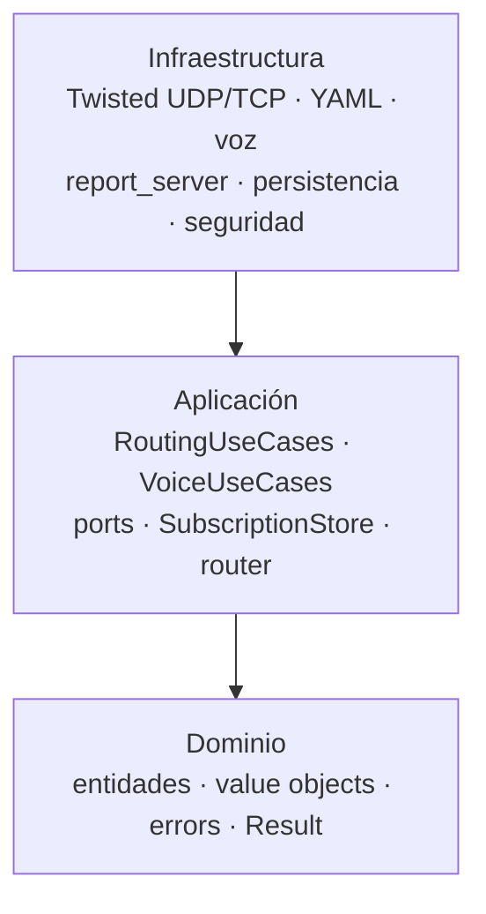

# Arquitectura (capas limpias)

## Capas

1. **Dominio** (`src/adn_server/domain/`) — entidades, objetos de valor, errores, `Result`. Sin E/S, sin Twisted.
2. **Aplicación** (`src/adn_server/application/`) — casos de uso (`RoutingUseCases`, `VoiceUseCases`, …) y **ports** (interfaces).
3. **Infraestructura** (`src/adn_server/infrastructure/`) — config YAML, Twisted UDP/TCP, voz, persistencia, adaptadores de seguridad.

**Regla de dependencias:** infraestructura → aplicación → dominio (solo hacia dentro).

## Punto de entrada

`main.py` cablea configuración, temporizadores **LoopingCall**, fábricas para **HBPProtocol**, servidor de informes e inyecta casos de uso.

## Autoridad de enrutado en runtime

El enrutado de voz lo gobierna **`SubscriptionStore`** (suscripciones de dominio). `RoutingUseCases` orquesta `dmrd_received` y delega la resolución de reenvío a **`SubscriptionRouter`**.

Comparación conceptual con **`BRIDGES`** legacy: [BRIDGES vs Subscriptions](bridges-vs-subscriptions.md).

Cambios de rendimiento en 2.x (índices, informes, proxy integrado): [Rendimiento (2.x)](performance.md).

**Plugins drop-in** (bus de voz/unit-data, contrato `ServerPlugin`): [Guía de plugins](../user-guide/plugins.md). La raíz del repositorio incluye `plugins/voice-announcements/` (activado por defecto) y el skeleton de referencia `plugins/example/`.

- **`InMemoryAclRouter`** (port `AclRouter`) — solo comprobaciones ACL (`acl_check`).
- **`routing_table_for_report()`** — shim de exportación para monitor/informes (forma legacy BRIDGE_SND); no se usa para reenvíos en runtime.

Los opcodes wire y claves YAML pueden seguir diciendo “bridge” por compatibilidad con el monitor legacy (`BRIDGE_SND`, `GEN_STAT_BRIDGES`).

## Dónde leer código

| Tema | Ubicación |
|------|-----------|
| Enrutado de voz, `dmrd_received`, reenvío OpenBridge | `application/routing_use_cases.py`, `application/routing/` |
| Store de suscripciones, router, reglas in-band | `application/subscription/` |
| HBP / OpenBridge UDP | `infrastructure/twisted_adapters/udp_hbp.py` |
| Admisión, motor y sesión OpenBridge | `domain/mesh_admission.py`, `domain/mesh_engine.py`, `domain/mesh_session.py` |
| Replay de capturas OpenBridge (`--replay`) | `infrastructure/obp_replay.py` |
| Loop guard | `application/routing/loop_guard.py` |
| Framework de plugins | `application/plugins/` |
| Informes TCP | `infrastructure/twisted_adapters/report_server.py` (fábrica), eventos de routing desde casos de uso |
| Voz / TTS | `application/voice_use_cases.py`, `infrastructure/voice/`; anuncios programados y TTS en `plugins/voice-announcements/` (`plugin/infrastructure/tts_engine.py`) |
| Proxy hotspot (fan-in) | `infrastructure/proxy/` (`udp_fanin.py`, `runtime.py`), casos de uso en `application/proxy/` |
| Self-service (MySQL) | `infrastructure/proxy/self_service_bridge.py`, `infrastructure/proxy/persistence/` |
| Persistencia TG dinámicos | `application/dynamic_tg_use_cases.py`, `infrastructure/persistence/dynamic_tg_repository.py`, `application/routing/dynamic_tg_restore.py` |

## Configuración como estado compartido

Un **`config` dict** mutable se pasa por adaptadores; actualizaciones en tiempo de ejecución (opciones, `SUB_MAP`) permanecen visibles globalmente durante la vida del proceso. El estado de cada enlace OpenBridge (keepalive, peer aprendido, tabla de quench) vive en `ObpBridgeSession` (`domain/mesh_session.py`); en `STATUS` solo queda el flag `_bcsq` por stream.
